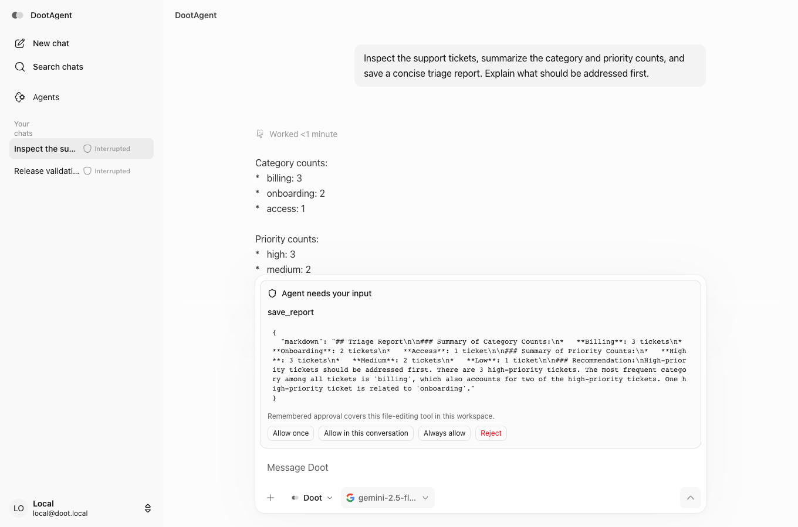

# Doot web

A Next.js/React interface for Doot's stateful agents: streaming conversations, tool activity, human approvals and restored thread history.

**Built on [LangChain Open Agent Platform](https://github.com/langchain-ai/open-agent-platform).** This is Aryaveer's extended client, not a from-scratch replacement. See [NOTICE](NOTICE.md) for the contribution boundary.

[Watch the original browser-agent demo](public/dootagent-demo.mp4). This historical recording uses a real browser session and demonstrates the earlier browser automation workflow.

The matching [Doot backend](https://github.com/Veer376/doot-agent) contains the architecture walkthrough, supported API, synthetic example and recorded demonstration.

## Current backend verification

The release preparation also verifies a separate ticket-triage workflow with a live model: tool calls → review proposed report → approve → persisted result after reload.



## Run

Start the backend using its `compose.showcase.yml`, then:

```sh
# Node.js 22; pnpm 9.15.4
corepack pnpm install --frozen-lockfile
cp .env.local.example .env.local
corepack pnpm dev --hostname 127.0.0.1
```

Open http://127.0.0.1:3000. Ask the agent to inspect the support tickets and save a triage report. Review the proposed report and approve or reject the write. The backend stores approved output locally.

`NEXT_PUBLIC_PLATFORM_MODE=true` selects the custom-backend UI profile. `NEXT_PUBLIC_LOCAL_MODE=true` uses the local demo session. The newer local agent's machine/workspace controls are separate capabilities and are not shown in this profile. This configuration is for localhost only.

The browser connects to `/api/langgraph`; the Next.js server proxies to `LANGGRAPH_API_URL`. Provider keys live in the backend environment. `DOOT_GATEWAY_TOKEN`, if used for a separately configured upstream, is server-only. A gateway token does not make the local demo a public multi-user service.

For a compiled local server:

```sh
corepack pnpm typecheck
corepack pnpm build
corepack pnpm start:local
```

Rebuild after source changes. The production launcher uses Next’s standard server and binds to localhost.

## What Aryaveer added

Conversation/tool presentation, previews and annotations; model controls; run activity and reconnect behavior; human approval/resume interfaces; local-runtime integration and startup optimizations. The source also retains experimental Electron/local-agent hooks; Electron distribution is outside this release.

The supported demo proves a defined subset of these features. It does not establish production reliability, secure public hosting or support for every historical UI action. The backend README lists unsupported endpoints.

## License

MIT, preserving the original Open Agent Platform notice and credit. The backend has different licensing; see its NOTICE.
